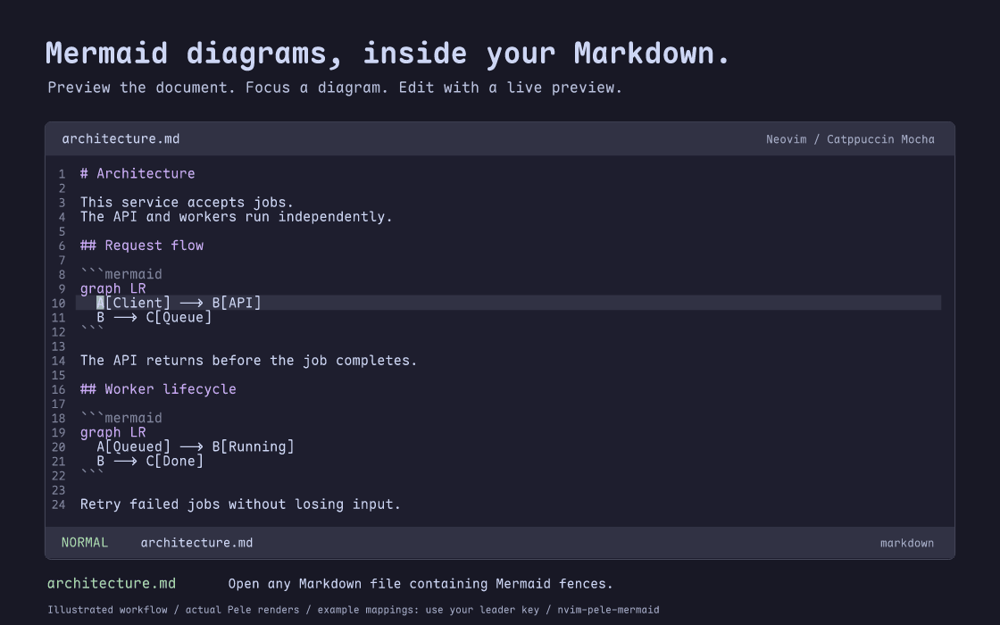

# nvim-pele-mermaid

**Preview Mermaid, right in your Markdown.**

Architecture notes, a README, a design document—wherever you keep Mermaid fences, see the diagrams without leaving Neovim. Toggle a reading view that keeps your headings and prose around the diagrams, preview just the diagram under your cursor, or keep a live side preview while you edit the Markdown source.



[Watch the 24-second workflow](assets/preview.mp4) · [Static preview](assets/preview.png)

With the example mappings below: **`<leader>mm`** toggles the document's Mermaid reading view, **`<leader>mp`** opens the focused diagram, and **`<leader>ms`** toggles its live side preview. Use your configured leader key. Edit a fence and the preview regenerates automatically; move to another fence and it follows your cursor.

*Illustrated in Catppuccin Mocha with [fframes](https://fframes.studio/) and actual diagrams rendered by [Pele](https://pele.run/)—not a screen recording. The plugin defines no global mappings; the demonstrated shortcuts use the example configuration below.*

## Install

Requires **Neovim 0.11+**, **Bun for dependency installation**, **ImageMagick (`magick`)**, [image.nvim](https://github.com/3rd/image.nvim), and a Kitty-graphics terminal such as **Tern**, Kitty, or Ghostty. Rendering supports Bun or Node.js 20+ after installation. Install **resvg** for rasterization; rsvg-convert and ImageMagick are also supported. ImageMagick remains required for image processing and inspector cropping. PNG clipboard copy uses `wl-copy` on Wayland, `xclip` on X11, or the macOS pasteboard. Rust is **not** needed to use the plugin; it is only used to rebuild the demo video (see [CONTRIBUTING.md](CONTRIBUTING.md)).

```lua
{
  "ruslan-kurchenko/nvim-pele-mermaid",
  tag = "v0.1.0",
  ft = "markdown",
  build = "build.lua",
  dependencies = { "3rd/image.nvim" },
  config = function()
    require("image").setup({
      backend = "kitty",
      processor = "magick_cli",
      integrations = { markdown = { enabled = false } },
      editor_only_render_when_focused = false,
      window_overlap_clear_enabled = true,
    })
    require("pele_mermaid").setup({})
  end,
  keys = {
    { "<leader>mm", "<cmd>MermaidToggle<cr>", ft = "markdown", desc = "Mermaid reading view" },
    { "<leader>mr", "<cmd>MermaidRefresh<cr>", ft = "markdown", desc = "Refresh diagrams" },
    { "<leader>mp", "<cmd>MermaidPreview<cr>", ft = "markdown", desc = "Mermaid float" },
    { "<leader>ms", "<cmd>MermaidSplit<cr>", ft = "markdown", desc = "Mermaid live split" },
    { "<leader>mz", "<cmd>MermaidInspect<cr>", ft = "markdown", desc = "Mermaid inspector" },
    { "<leader>ml", "<cmd>MermaidList<cr>", ft = "markdown", desc = "Find diagram" },
    { "<leader>my", "<cmd>MermaidYank<cr>", ft = "markdown", desc = "Copy diagram PNG" },
    { "<leader>mf", "<cmd>MermaidFix<cr>", ft = "markdown", desc = "Repair Mermaid syntax" },
    { "<leader>me", "<cmd>MermaidExport<cr>", ft = "markdown", desc = "Export diagram" },
    { "]m", "<cmd>MermaidNext<cr>", ft = "markdown", desc = "Next diagram" },
    { "[m", "<cmd>MermaidPrev<cr>", ft = "markdown", desc = "Previous diagram" },
  },
}
```

If image.nvim is already configured, merge these options into its existing setup rather than setting it up twice.

The `build = "build.lua"` hook runs `bun install --frozen-lockfile` in the plugin directory, so the renderer's JavaScript dependencies match the committed `bun.lock` exactly; it fails rather than updating the lockfile. The hook finds Bun even when a GUI launcher omits `~/.bun/bin` from `PATH`. It runs on install and update; if dependencies are missing, run `:Lazy build nvim-pele-mermaid`, then `:checkhealth pele_mermaid`.

`tag = "v0.1.0"` pins that exact release, so lazy.nvim will not move to newer ones on its own. To upgrade, read the [changelog](CHANGELOG.md), change the tag to the newer release (for example `tag = "v0.1.1"`), then run `:Lazy sync` (or `:Lazy update nvim-pele-mermaid`). Under 0.x versioning, a minor bump such as `v0.2.0` may include breaking changes with migration notes; patch releases are compatible.

## Read, edit, inspect

- **Open:** normal editable Markdown, without rendering every diagram at startup.
- **Read:** `MermaidToggle` replaces fences with diagram anchors in a separate, nonmodifiable projection. Visible diagrams render first; remaining diagrams prefetch while idle. Toggle back to the corresponding source position. The source is never rewritten by rendering.
- **Edit:** use the tab-local live split or float. Latest-generation results replace previews; incomplete syntax retains the last valid diagram and reports a diagnostic.
- **Navigate:** `]m` / `[m` jump between diagrams; `MermaidList` selects one by section title.
- **Inspect:** `MermaidInspect` opens a large view. `+` / `-` zoom, `0` resets, `h/j/k/l` pan, and `q` / Escape close.
- **Copy:** `MermaidYank` places a 2× PNG on the system clipboard.
- **Repair:** `MermaidFix` repairs supported common label/quoting mistakes in the source. Unlike rendering, this command intentionally edits text; normal undo applies.
- **Export:** `MermaidExport diagram.svg` or `diagram.png`; `MermaidExportAll directory` exports SVGs in document order. Existing files are protected unless `!` is supplied.
- **Refresh:** `MermaidRefresh` bypasses artifact-cache reuse. `checkhealth pele_mermaid` checks dependencies.

The plugin defines no global mappings. Examples above scope mappings to Markdown.

## Fonts and themes

**Maple Mono NF is bundled**, including regular, bold, italic, and bold-italic faces under the [SIL Open Font License](assets/fonts/LICENSE.txt). No system-font installation is needed. SVG exports embed fonts; rasterization outlines text using the same bundled files.

```lua
require("pele_mermaid").setup({
  debounce_ms = 100,
  mermaid = {
    theme = "nvim", -- active editor colors; also catppuccin-mocha, light, dark, default
    options = { padding = 8 },
  },
  inline = { enabled = true, max_width = 0.90, max_height = 0.60 },
  float = { max_width = 0.90, max_height = 0.80 },
  split = { position = "right", width = 0.45 },
  cache = { max_bytes = 100 * 1024 * 1024, max_age_days = 7 },
})
```

Fractional dimensions are shares of the window; positive integers are cells. `nvim` derives colors from editor highlights and falls back to dark/light appearance. `catppuccin-mocha` selects its palette independently. Explicit `bg`, `fg`, `line`, `accent`, `muted`, `surface`, and `border` override the selected theme. Full supported options live in [`config.lua`](lua/pele_mermaid/config.lua).

Tern placement uses native PNG pixels rather than stretching images to rounded cell rows. A persistent renderer and shared atomic SVG/PNG cache serve every preview target. Diagrams are rendered exclusively with Pele. See [Pele syntax compatibility](https://pele.run/compatibility).

Cache limits apply to reusable disk artifacts, pruned periodically (within 60 seconds after a burst). Active previews, in-flight exports, and the last-valid preview of an unfinished fence retain private files until released; off-screen prefetch does not. Dead-process leases are reclaimed at startup. Renderer deadlines start when work begins, not while queued; outline and raster subprocess phases each have their own configured timeout.

## Markdown renderer compatibility

Let this plugin own Mermaid fences. For `render-markdown.nvim`:

```lua
opts = { code = { disable = { "mermaid" } } }
```

For `markview.nvim`, preserve other code blocks while excluding Mermaid:

```lua
opts = {
  markdown = {
    code_blocks = function(_, block)
      if block.language == "mermaid" then return nil end
      return require("markview.config.markdown").code_blocks
    end,
  },
}
```

Keep image.nvim's focused-editor clearing disabled in Tern. Completion snippets and ghost text are separate: use the Mermaid snippet language inside Mermaid fences, not Markdown table snippets.

## Development

Contributions are welcome; see [CONTRIBUTING.md](CONTRIBUTING.md) for setup, the test commands, and manual terminal-graphics checks. The Rust project under `preview/` only rebuilds the demo video, GIF, and poster. It is development-only and is never built or run by installing the plugin.

## Credits

Rendering by [Pele](https://github.com/obsidianmd/pele), terminal graphics by [image.nvim](https://github.com/3rd/image.nvim), typography by [Maple Mono](https://github.com/subframe7536/maple-font). Code: [MIT](LICENSE); bundled Maple Mono fonts retain their separate [SIL OFL](assets/fonts/LICENSE.txt).
