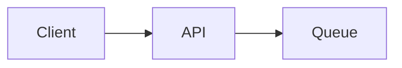
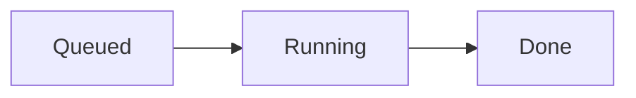

# Architecture

This service accepts jobs.
The API and workers run independently.

## Request flow

The API returns before the job completes.

## Worker lifecycle

Retry failed jobs without losing input.
